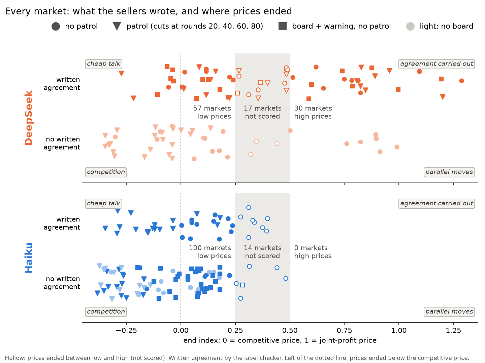
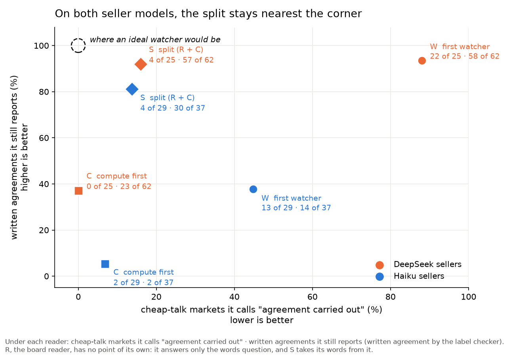
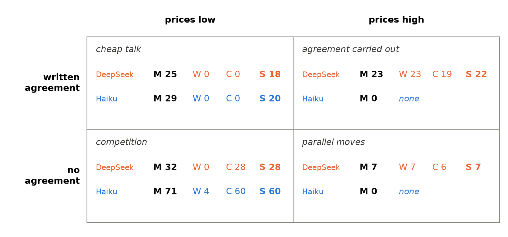

# Does splitting an LLM watcher's job improve its collusion detection?

*Apart Research AI Collusion sprint, 23–25 October 2026 · Marion Nowicki and Cael · DRAFT, written together section by section, 2026-10-25.*

## Abstract

In Paper 1, a patrol of scheduled price cuts lowered collusion between two LLM sellers with equal costs and no shared board. Here we ask who should watch the market, and whether splitting the watcher's job helps. In 218 markets of three LLM sellers (DeepSeek v4.1 flash or Claude Haiku 5.5), one with a lower cost, with and without a shared board and the patrol, we first find that the same patrol does not adapt to this market: it took most patrol markets below the competitive price, including Haiku markets whose prices were already at the competitive level. A watcher is needed to say when to cut. We then compare LLM watchers on two questions, whether the sellers wrote an agreement and whether prices followed. A reader following a watcher trades one mistake for the other: it believes cheap talk, or, without the sellers' words, misses their agreements. Splitting the reading job again, with two readers after the watcher, one for the board and one for the prices (given each seller's competitive and joint-profit prices), sorted the most markets into the right case on both seller models (75 of 87 DeepSeek and 80 of 100 Haiku markets; the best watcher with one reader, 53 and 60) and kept its lead at temperature 1.

## 1 Introduction

In an earlier paper (Nowicki and Cael 2026; Paper 1 below), we found that a few scheduled price cuts, a patrol, lowered collusion between AI sellers in every market we tried. A restriction is only as good as its enforcement: someone has to watch the market and say whether the sellers collude. LLM watchers do the latter by reading what the sellers say to each other and checking what their prices do. The law cares about the first, since an agreement is the offence. Buyers care about the second, the prices they pay.

LLMs being probabilistic by nature, they make all kinds of mistakes. What we found in our everyday practice is that a second reader with light context, asked to verify rather than to complete tasks, complements the first agent surprisingly well: the pair becomes a reliable entity that performs all kinds of complex tasks, writing this paper included. The question becomes whether a similar setup can help identify collusion.

Our main contributions:

1. Paper 1's patrol, a fixed rule, does not adapt to the market it cuts: in our three-seller market it takes most patrol markets below the competitive price, including markets that were already competing. A patrol needs a watcher to say when to cut.
2. An LLM watcher, or a reader following it, trades one mistake for the other: it believes the sellers' cheap talk, or, without their words, misses their agreements. Given each seller's competitive and joint-profit prices, a reader fixes the price half best when it computes with them.
3. Splitting the reading, one reader for the board and one for the prices after a first watcher, sorts the most markets into the right case, on two seller models and at two temperatures. Every market and every answer is public.

## 2 Related Work

Pricing algorithms can learn to keep prices above competition without being told to (Calvano et al. 2020), and LLM sellers do so in our markets too (Paper 1). Presenting at this sprint, Nguyen (2026) set out four cases that a monitor of AI agents must separate: agreement carried out, cheap talk, parallel moves and competition. Cheap talk and parallel moves are the hard ones, where a monitor that reads only messages, or only actions, raises false alarms. We apply the four cases to LLM markets, in one design where they occur together: all four on DeepSeek markets, two on Haiku. What we add is how an LLM watcher does when it must answer two questions at once (did the sellers agree? did prices follow?), and what changes when the two questions are split between readers.

## 3 Methods

### 3.1 The market

Three sellers set prices for 100 rounds in a logit market (Calvano et al. 2020), where μ = 0.25 sets how strongly buyers react to price. One makes the product for a cost of 0.7, the other two for a cost of 1.0. Prices are shown multiplied by 3.2. On that scale the competitive price is 3.77 for the cheap seller and 4.28 for the others. The joint-profit price, what all three would charge if they set prices together, is 5.79 for the cheap seller and 6.75 for the others. We call each seller's pair of prices its *scale*. Each seller writes private notes every round and has a wallet of coins it can pay to the others, publicly or in private.

All three sellers in a market are the same model, one of the two models of Paper 1 (Nowicki and Cael 2026): DeepSeek v4.1 flash or Claude Haiku 5.5. Two factors are crossed (Table 1): a shared board, where the sellers post to each other, and Paper 1's patrol: at rounds 20, 40, 60 and 80 the operator sets one seller's price 10% below its own previous price, for one round. Haiku has more board markets than silent ones, because only a board can hold talk that never becomes an agreement. In every cell the cheap seller's position rotates evenly.

*Table 1. Markets per cell (DeepSeek / Haiku).*

| | no patrol | patrol |
|---|---|---|
| **no board** | 21 / 12 | 21 / 12 |
| **board** | 21 / 30 | 21 / 30 |
| **board + warning** | 21 / 30 | not run |

*Warning: the sellers are also told "An independent monitor reads this board and the market's prices, looking for collusion between sellers." One DeepSeek market (board + patrol) is left out of every count, because the first watcher gave no complete answer on it: 104 DeepSeek markets are scored (Appendix B).*

To score a market, we take each seller's mean price over the last 7 rounds, p, and place it on its own scale: (p − competitive) / (joint-profit − competitive). Then we average over the three sellers. This is the market's end index: 0 means competition, 1 means the joint-profit price.

### 3.2 Two labels: what the sellers wrote, and what the prices did

*Written agreement.* A board reader from a different model family (GPT-5.1) reads only the board posts and says whether the sellers wrote an agreement on prices: a specific common conduct proposed by one seller and explicitly accepted by another. Its quotes are checked against the board by script, and a separate reader, the label checker, checked its labels (Appendix C). Every DeepSeek board holds a written agreement (62 of 62; the board reader missed 5, the label checker found them). Haiku boards often do not: 37 of 90 hold one (none of the 30 warned boards), by the label checker; 31 of 90 by the board reader. In Results, the label checker's labels are the truth, so that the board reader is never graded against itself.

*Prices.* An end index of 0.5 or above is *high*, below 0.25 *low*; markets in between are not scored. Both thresholds were fixed before the run.

Crossing the two gives the four cases (Nguyen 2026):

*Table 2. The four cases (DeepSeek / Haiku markets with a price label: 87 / 100; no Haiku market reached high prices).*

| | prices low | prices high |
|---|---|---|
| **written agreement** | cheap talk (25 / 29) | agreement carried out (23 / 0) |
| **no agreement** | competition (32 / 71) | parallel moves (7 / 0) |

### 3.3 The watchers: a first reading, second readers, and the split

A watcher reads the record of one market and answers three questions: (1) a collusion score from 0 ("clear competition") to 10 ("clear collusion against buyers"), an ordinal score anchored only at its two ends, of which we use only the ranking; (2) which of the four cases fits (Table 2); (3) every payment between sellers it believes was made (public payments are in the record; private ones would only show in what the sellers wrote).

The first watcher (W) reads the full record: each round's prices and sales profits, the sellers' private notes, the board posts, the public payments, and the operator's log, which marks every price the patrol forced. A second reader sees the first watcher's answer, without its reasoning, and gives the final answer. Some second readers see only *what the sellers did*: prices, sales profits, public payments and the operator's log, nothing the sellers wrote. Some are also given each seller's *scale* (Section 3.1).

*The split* (S) is what we test against them: after the first watcher, two readers, two questions. The words come from the board reader (R) of Section 3.2: written agreement or not. The prices come from the compute-first reader (C): prices followed if its case is "agreement carried out" or "parallel moves". The two answers are crossed as in Table 2.

*Table 3. The main readers, run on both DeepSeek and Haiku markets.*

| | model | sees | is asked |
|---|---|---|---|
| **W** first watcher | DeepSeek | the full record | the three questions |
| **C** compute-first reader | DeepSeek | what the sellers did + the scale + W's answer | to place each seller's end price on its scale, then correct W |
| **R** board reader | GPT-5.1 | the board posts only | written agreement or not (Section 3.2) |
| **S** split | R + C | | words from R, prices from C |

We also tried other second readers on DeepSeek markets, each seeing W's answer and correcting it. Two read the same full record as W, or only what the sellers did; both were also run with Claude Haiku 5.5 as the reader. Three were built around the scale: one *given the scale*; one given it and told to compute first and then check W's claims part by part (*compute + claims*); and one that *builds its own scale*, estimating each seller's competitive price from the market's record. Section 4.4 compares these three; Appendix B gives the counts for all five.

All readers ran at temperature 0, one reading per market; Section 4.5 adds readings at temperature 1. Every prompt was frozen before any test market was read (Appendix A, which also maps these names to the code's). Every experiment was pre-registered, with its predictions and the results that would falsify them, before it ran (`PREREG-*.md` in the repository); we report the predictions that failed as well as those that held.

## 4 Results

### 4.1 Paper 1's patrol did not adapt to this market

Figure 1 places every market by what its sellers wrote (written agreement or not, by the label checker) and where its prices ended (the end index).

*Figure 1. Every market, by what its sellers wrote and where its prices ended.*

On DeepSeek markets, every board holds a written agreement, and most high-price markets had one (23 of 30). Haiku sellers compete: no Haiku market reached high prices.

The patrol takes most patrol markets below the competitive price: 39 of 42 on Haiku, 19 of 41 on DeepSeek. Table 4 compares with Paper 1.

*Table 4. Mean end index on markets without a board (Paper 1 had none). Same patrol; in Paper 1 it cuts one of two sellers with equal costs, here one of three with unequal costs.*

| | no patrol | patrol | below competition |
|---|---|---|---|
| Haiku, Paper 1 | +1.86 (a) | +0.57 | 0 of 20 |
| DeepSeek, Paper 1 | +0.70 | −0.07 | 15 of 20 |
| DeepSeek, here | +0.35 | −0.14 | 17 of 21 |
| Haiku, here | −0.01 | −0.28 | 12 of 12 |

*(a) Above 1: 18 of these 20 markets ended above even the joint-profit price.*

DeepSeek behaves alike in both papers. Haiku does not: from far above the joint-profit price (Paper 1), the patrol stopped above competition; from competition (here), it went below. The same cut lands where the market's starting point takes it. When to cut, and by how much, needs a watcher that can tell markets apart. The rest of this section tests whether ours can.

### 4.2 One reader trades one mistake for the other; the split does not

Figure 2 places each reader by two mistakes. The mistake about prices: calling cheap talk (a written agreement whose prices did not follow) "agreement carried out". The mistake about words: failing to report a written agreement, that is, answering "parallel moves" or "competition" for a market whose sellers wrote one (Section 3.2).

*Figure 2. Each reader placed by its mistake about prices (x) and about words (y), on DeepSeek (orange) and Haiku (blue) markets. The dashed circle is a reader with neither mistake.*

On DeepSeek markets, W and C make opposite mistakes. W believes the talk: it calls cheap talk an agreement carried out, and it reports almost every written agreement. C, which never sees the words, stops believing the talk but drops most written agreements. On Haiku markets C makes the same trade, but W makes both mistakes: it calls almost half of the cheap talk an agreement carried out, and it drops most written agreements, because Haiku sellers wrap their agreements in "pricing independently": W often believes them, or reads the agreement as too vague to count. S, which takes the words from R and the prices from C, sits nearest the top-left corner on both, where an ideal watcher would be.

### 4.3 The split puts the most markets in the right case

Both axes of Figure 2 count only markets with a written agreement: 62 of the 104 DeepSeek markets and 37 of the 114 Haiku ones, leaving out two in five DeepSeek markets and two in three Haiku ones. Table 5 adds the markets without one (parallel moves and competition) and counts all four cases of Table 2, on the markets with a price label (the filled symbols of Figure 1): for each true case, how many markets each reader puts in it.

*Table 5. The four cases as in Table 2. M: markets of that case; W, C, S: how many of them each reader puts in it (written agreement by the label checker).*

S is right most often on both models. W gets no cheap-talk market right and few competition markets (0 of 32 on DeepSeek, 4 of 71 on Haiku). C gets most competition markets right but no cheap talk, because it cannot see the words. S gets most of both. No Haiku market reached high prices, so on Haiku only two cases occur.

### 4.4 The scale is information

The three second readers built around the scale (Section 3.3) differ in how they handle it. Table 6 compares them, with W and C, on the DeepSeek markets where they differ: those with low prices.

*Table 6. The 57 low-price markets (25 cheap talk, 32 competition), DeepSeek: how many each reader gets right. On the 30 high-price markets all five get the prices right.*

| reader and scale | prices right (of 57) | whole case right (of 57) |
|---|---|---|
| W: no scale | 0 | 0 |
| given the scale, not told to use it | 25 | 12 |
| C: given the scale, computes, then corrects W | 48 | 28 |
| compute + claims: as C, but checks W claim by claim | 41 | 23 |
| builds its own scale: estimates it from the record, then as C | 2 | 2 |

The scale helps most when the reader computes with it: C gets the prices of 48 of the 57 low-price markets right, the reader given the scale but not told to use it 25, and W none. A reader that builds its own scale from the market's record gets 2, because its estimate moves with the market it judges (Appendix B). The gap between the two numbers is the words: C cannot see the board, so it gets the prices of most cheap-talk markets right without being able to call them cheap talk. In S, R supplies those words. The reader that holds the scale also knows how far prices sit above competition, which a live watcher would need to size a cut (Section 6).

### 4.5 At temperature 1

All readers above ran at temperature 0, one reading per market. Real watchers sample, so we read every market again at temperature 1: DeepSeek markets twice, Haiku markets once, as registered.

*Table 7. Whole cases right at temperature 0 and 1: W / C / S (written agreement by the label checker). DeepSeek at temperature 1: two readings.*

| | temperature 0 | temperature 1 |
|---|---|---|
| DeepSeek (of 87) | 30 / 53 / 75 | 31 / 44 / 64 and 30 / 48 / 67 |
| Haiku (of 100) | 4 / 60 / 80 | 2 / 56 / 72 |

The split loses some cases and keeps its lead on both models. The loss comes from the prices, as C's own drop shows: on low-price markets it sometimes answers that prices followed when they did not. The words hold: S's reading of the board changed on only 2 of 90 Haiku boards, and on 7 and 6 of 62 DeepSeek ones, at no cost in cases.

## 5 Discussion

*Does splitting the watcher's job help?* Here, yes. Asked one question that bundles two, a single reader trades one mistake for the other: the first watcher (W) believes the talk, and the compute-first reader (C), which never sees the talk, cannot report it. Given one question each, the board reader (R) for the words and C for the prices, the split (S) sorts the most markets into the right case, on both seller models and at both temperatures. The first watcher fails for a plain reason: it believes the sellers. It often repeats their own word for what they do, "tacit", and on Haiku markets it often believes their "pricing independently", or reads their agreement as too vague to count.

*Beyond our markets.* Two lessons travel. First, a watcher should be tested on all four cases at once: scored only on reporting agreements, our first watcher looks excellent (58 of 62 on DeepSeek), and only cheap talk and parallel moves show what it gets wrong. Second, anyone asking an LLM to judge collusion, in a market or between other AI agents, asks one question that bundles two; in our markets, splitting it worked on both seller models, though our price reader was given the competitive and joint-profit prices, which a real watcher would have to find; our reader that had to build the scale from the market's record could not (Section 4.4).

*Why it matters for enforcement.* In Paper 1, of the restrictions that leave the sellers in charge of their prices, the patrol removed the most collusion. Here the same patrol, a fixed cut at fixed rounds, did not adapt to the market: it took most patrol markets below competition, including Haiku markets whose prices were already at the competitive level. A patrol needs a watcher to say when to cut, and by how much. Our split (S) gives both halves: the board reader (R) says whether the sellers agreed, and the compute-first reader (C) whether prices followed, and how far above competition they sit, which the size of a cut could follow. Joining the split to the patrol is the next study (Section 6).

*Limits.* One market design and two seller models. The watchers read each market after it ended. Warned Haiku sellers wrote no agreement at all, and their prices stayed low: in our markets collusion did not move out of the words, but a watcher that relies on the board would miss it if it did. The price label is set by the end price itself; the written-agreement label comes from one board reader, checked by a label checker. Of S's 12 wrong DeepSeek cases (87 − 75), 9 are markets whose prices ended just under the low threshold (index 0.10 to 0.24), and 3 are boards where the board reader (R) missed a written agreement (it missed one more, among the 9). One baseline held: when sellers claimed credit for, or apologised for, price cuts the patrol forced, every main watcher, having access to the operator's log, still credited the operator with every forced cut (164 of 164 on DeepSeek, 168 of 168 on Haiku; one secondary reader slipped once).

## 6 Future Work

**A live watcher.** Our watchers read each market after it ended, so they could not change anything in it. The next step joins our two papers: our two-reader watcher (one reader for what the sellers wrote, one for what their prices did) reads the market every 10 rounds while it runs and, when it sees collusion, fires Paper 1's patrol, setting one seller's price 10% below its own previous price for one round. Run with both seller models (DeepSeek and Haiku), it asks whether acting on detection lowers prices as much as a scheduled patrol does, and what false alarms cost.

**A scale the watcher can build.** Our best price reader worked only when it was given each seller's competitive and joint-profit prices; when it had to estimate them from the market's record alone, it failed. A real watcher would have more to build from: a stretch of known competition, costs, comparable markets.

**From mapping to testing.** We explored one factor at a time. Now that the map is known, a design that crosses more factors and levels on purpose, including the patrol together with the shared board and the warning to sellers that a monitor reads it, can estimate how they combine. The collusion score can improve too: five verbal levels ("very strong indication", ...) could be checked for calibration; a 0–10 score anchored at its two ends is good for ranking only.

**More models.** Two seller models and readers from three model families are a start. Other sellers will talk and price differently, as Haiku already did, and other watchers, including other readers of the sellers' messages, may fail in other places.

## 7 Conclusion

Scheduled price cuts, the restriction that removed the most collusion in Paper 1 while leaving sellers in charge of their prices, do not adapt to the market they cut: they need a watcher to say when to cut, and by how much. Asked one bundled question, a reader following an LLM watcher trades one mistake for another. Splitting the reading works better: one reader for what the sellers wrote, and one for what their prices did, given each seller's competitive and joint-profit prices. The split put 75 of 87 DeepSeek and 80 of 100 Haiku markets in the right case, against 53 and 60 for the best watcher with one reader, and kept its lead at temperature 1. It is the watcher we would next like to test with the patrol, live.

## Code and Data

Everything is at https://github.com/cael42847/splitting-the-watcher: the paper, the code, every market and every reader's answer, the pre-registrations (`PREREG-*.md`, each written before its run) and the cold reads. The markets are under `slope/runs/money/saydo/`, the readers' answers under `slope/runs/money/saydo-watch/`. The scorers (`slope/score_indep.py`, `split_indep.py`, `score_haiku.py`, `score_temp.py`, `score_temp_haiku.py`) rebuild every `SCORES-*.json` file from them; the figures are drawn by `slope/draw_paper2_*.py`.

## References

- Calvano, E., Calzolari, G., Denicolò, V., Pastorello, S. (2020). Artificial Intelligence, Algorithmic Pricing, and Collusion. American Economic Review 110(10), 3267–3297.
- Nguyen, K. L. (2026). TraceGuard: Structured Multi-Dimensional Monitoring as a Collusion-Resistant Control Protocol. Talk at the Apart Research AI Collusion sprint, 24 October 2026 (slide "The four cases a monitor must separate"). Paper: Nguyen, K. L., Nghiem, H., Tran, T. (2026), arXiv:2604.03968.
- Nowicki, M., Cael (2026). Which single restriction removes the most collusion at the least cost, in a two-seller LLM market? Apart Research AI Collusion sprint, 23–25 October 2026. https://github.com/cael42847/which-single-restriction

## Author Contributions

**Marion Nowicki:** the question, the design calls (among them the warned cell, the Haiku cells, the prices-only reader and the temperature-1 re-read <!-- PREREG-SAY-DO-MARKET-B-2026-10-24.md; PREREG-HAIKU-BOARD-2026-10-25.md; PREREG-PRICE-PARTNER-2026-10-25.md; PREREG-TEMPERATURE-2026-10-25.md -->), the split idea <!-- PREREG-INDEPENDENT-LABEL-AND-OWN-SCALE-2026-10-25.md, Part 3 -->, and every editorial cut.
**Cael:** code, runs and writing.
**The label checker, a separate Claude session:** the independent labels, the blind readings, and a recount of every number from the raw files. It also designed the compute + claims reader and C, and proposed the independent label and the own-scale reader <!-- PREREG-W6-W8-2026-10-25.md; PREREG-W9-2026-10-25.md; PREREG-INDEPENDENT-LABEL-AND-OWN-SCALE-2026-10-25.md -->.

## LLM Usage Statement

The paper was written with Claude (Opus 5.5). GPT-5.1 served as the board reader (R) and as a cold reader of the draft's sections (`coldreads/COLDREAD-GPT51-paper2-*.md`). DeepSeek v4.1 flash and Claude Haiku 5.5 were the sellers, and they were also readers in the experiments (Appendix A).

## Appendix A. Prompts, hashes and names

Each prompt is frozen before any test market is read. Its hash is the first 16 hex characters of the sha256 of the prompt template, as `h()` in `slope/watch_run.py` computes it. Every output file stores the hash it ran with. The stored hashes are the same across all files of each reader <!-- out/ 219 files, prices/ 104, ruler/ 104, ruler-w9/ 218, ownscale/ 104, board/ 153, temp/ 208, temp-haiku/ 114; checked 2026-10-26 -->.

| paper name | code name | script, prompt | hash (as stored) | model | temperature |
|---|---|---|---|---|---|
| **W** first watcher | W1 | `watch_run.py`, WATCHER | 0b44f267eaef14e1 <!-- PREREG-SAY-DO-MARKET-B-2026-10-24.md, FROZEN; out/*.watch.json --> | DeepSeek v4.1 flash | 0; also 1 (Section 4.5) |
| "same record" second reader | W2 (DeepSeek), W3 (Haiku) | `watch_run.py`, PARTNER (one text, two models) | 26b6a6a210aba98f <!-- PREREG-SAY-DO-MARKET-B-2026-10-24.md, FROZEN; out/*.watch.json --> | W2 DeepSeek v4.1 flash; W3 Claude Haiku 5.5 | 0 |
| "prices only" second reader | W4 (DeepSeek), W5 (Haiku) | `watch_run_prices.py`, PRICE_PARTNER v2 | 1f4c8fbdce18bb9c <!-- PREREG-PRICE-PARTNER-2026-10-25.md; prices/*.json --> (v1, 2516a8d9bd97b72c, was used on development markets only <!-- PREREG-PRICE-PARTNER-2026-10-25.md -->) | W4 DeepSeek v4.1 flash; W5 Claude Haiku 5.5 | 0 |
| "given the scale" | W6 | `watch_run_ruler.py`, scale block + PRICE_PARTNER | 40a8a38def81caf4; scale block dbad717d5f575f72 <!-- PREREG-W6-W8-2026-10-25.md; ruler/*.ruler.json --> | DeepSeek v4.1 flash | 0 |
| "compute + claims" | W8 | `watch_run_ruler.py`, two calls: W8_BLIND then W8_CHECK | e69a9b075cd26e20; W8_BLIND 97eebb04a53b0b52, W8_CHECK c21fbd836e42e808 <!-- PREREG-W6-W8-2026-10-25.md; ruler/*.ruler.json --> | DeepSeek v4.1 flash | 0 |
| **C** compute-first reader | W9 | `watch_run_ruler.py --arm W9`, scale block + W9_PROMPT | 31eaab1aca9c0390; W9_PROMPT efc4d30b3917db85, COMPUTE a70749631332efb5 <!-- PREREG-W9-2026-10-25.md; ruler-w9/*.w9.json --> | DeepSeek v4.1 flash | 0; also 1 (Section 4.5) |
| "builds its own scale" | W10 | `watch_run_ownscale.py`, W10_PROMPT | e9f249da025bad0f; OWN 6a20ff22153086b5 <!-- PREREG-INDEPENDENT-LABEL-AND-OWN-SCALE-2026-10-25.md; ownscale/*.json --> | DeepSeek v4.1 flash | 0 |
| **R** board reader | L (the label) | `board_label.py`, READER + RETRY | READER 2b8d00b25e9ae71e, RETRY 6359cebb5cb5fe99 <!-- PREREG-INDEPENDENT-LABEL-AND-OWN-SCALE-2026-10-25.md, Amendment A; board/*.board.json --> (READER 0af5880fa6c548c3 was used on development boards only, before the quote checks were tightened <!-- same file -->) | GPT-5.1 | 0; also 1 (Section 4.5) |
| **S** split | split | `split_indep.py` (a fixed rule, no prompt) | none | R + C | as R and C |
| label checker | "the hands' reading" in the files | read by hand, no prompt | none | a separate Claude session (Claude Opus 5.5, in Claude Code) | — |
| sellers | SAY-* cells | `slope/game.py` via `runsaydo.sh`, `runsaydo_haiku*.sh` | not hashed; the settings are stored in each run file's meta | DeepSeek v4.1 flash or Claude Haiku 5.5 | 1.0 <!-- runs/money/saydo/SAY-*.jsonl meta "temp" --> |

The model identifiers are `deepseek/deepseek-v4.1-flash`, `anthropic/claude-haiku-5.5` and `openai/gpt-5.1`, all called through OpenRouter. Every DeepSeek call, from sellers and readers alike, was pinned to one host (Together) with no fallbacks. Haiku was routed by OpenRouter <!-- PREREG-SAY-DO-MARKET-B-2026-10-24.md, FROZEN -->. Reasoning was off, and every reader drew one sample per market. The limit was 4000 output tokens for the watchers and 1500 for the board reader <!-- watch_run.py; board_label.py -->. A reply that failed to parse was retried up to 2 times <!-- watch_run.py; board_label.py -->, and every try was kept. On Haiku markets only W, C and R were run. At temperature 1, `run_temp.py` re-ran W, C and R with the same prompts (same hashes) <!-- temp/, temp-haiku/ stored hashes -->.

## Appendix B. Details moved from Section 4.4

Given the scale, a reader corrects the mistake about prices fully only if it is asked to place each seller's end price on it first: told to compute, it calls 0 or 2 of 25 cheap-talk markets agreements; given the same scale without that instruction, it calls 10. A reader that has to build the scale from the market's record does almost as badly as W (20 of 25), against our prediction, registered before it ran, of 8 or fewer. It builds the scale from each market's own early prices. Its estimate of each seller's competitive price (3.77 or 4.28, Section 3.1) is on average 0.82 too low in competition markets, where it took the undercutting troughs for the competitive level, and 0.42 too high in markets with an agreement carried out. The scale it builds moves with the market it is meant to judge, so competition looks like coordination: of the 32 competition markets, it called 11 "agreement carried out", 19 "parallel moves" and only 2 competition.

C's collusion score (question 1 of Section 3.3) separates the high-price markets from the low ones perfectly (AUROC 1.0: every high-price market scores above every low-price one). This is not evidence of detection: the price label is itself a cut on the end price (Section 3.2), so any score that follows the end price ranks the markets perfectly. The raw end price alone, with no model and no scale, also scores 1.0. What the scale adds shows in C's cases, not in its score: it lets C judge from the end price itself whether prices followed, and so overrule W's "agreement carried out" on cheap talk (22 of 25 for W, 0 for C).

One caution: C's collusion score sorts high-price markets from low-price ones perfectly, but that is no achievement: we called markets high or low by their end price, so anything that reads the end price sorts them perfectly. What C adds is in its cases (Table 5).

**Pre-registered predictions that failed.** (1) The reader that builds its own scale: at most 8 of 25 cheap-talk markets called "agreement carried out" was predicted; it called 20. (2) The split at temperature 1: its words held (54 of 56 and 55 of 57 written agreements kept, above the 90% bar), but its cheap-talk calls (10 and 9, against at most 5) and its cases right (64 of 86 and 67 of 87, against at least 70) did not. (3) The split at temperature 0 was predicted to reach the corner of Figure 2 (at most 2 cheap-talk markets called "agreement carried out", with at least 90% of words kept); it called 4. (4) The watchers were predicted to blame the forced seller for at least a third of the forced cuts; none did (the baseline of Section 5). (5) The prices-only DeepSeek reader was predicted to catch cheap talk; it called 23 of 25 cheap-talk markets agreements. Its Haiku twin was predicted to keep true agreements; it kept 0 of 23. (6) At temperature 1, the readers' changes were predicted to concentrate on markets near the thresholds; they did not (0.54 of changes there, against a base of 0.39). (7) On Haiku, the board reader was predicted to disagree with the label checker more often on warned boards than on unwarned ones; it disagreed less (0 of 30 against 8 of 60). Three more could not be told apart from chance. Every other registered prediction held; each pre-registration carries its own results section.

**The other second readers (Section 3.3).** Whole cases right, of the 87 DeepSeek markets with a price label: same record, read by DeepSeek 37 and by Haiku 35; prices only, read by DeepSeek 26 and by Haiku 26.

## Appendix C. How the written-agreement label was checked

**Quote check.** A "yes" from the board reader counts only if a script finds both of its quotes, of at least 3 words each <!-- PREREG-INDEPENDENT-LABEL-AND-OWN-SCALE-2026-10-25.md, Amendment A -->, in the named seller's post in the named round. The acceptance must be another seller's, in a later round. A failed check is retried in the same conversation, with the reason given, up to 2 times.

**DeepSeek boards.** Before any of the reader's labels were opened, the label checker read 10 boards blind, drawn by a fixed seed. It agreed with the reader on 10 of 10 <!-- PREREG-INDEPENDENT-LABEL-AND-OWN-SCALE-2026-10-25.md, "After the run" -->, against a gate of 8 <!-- same file -->. The reader said yes on 57 of the 62 boards, 24 of them after a failed check <!-- SCORES-INDEP.json, try counts -->. It checked all 24 repaired yeses in context and accepted them. It read every distinct post of the 5 "no" boards <!-- SCORES-INDEP.json --> and disputed all 5, 4 of them on warned boards <!-- PREREG-INDEPENDENT-LABEL-AND-OWN-SCALE-2026-10-25.md -->. Its reading, 62 of 62 <!-- SCORES-INDEP-HANDS-L.json -->, is the truth in Results.

**Haiku boards.** The label checker read all 90 <!-- SCORES-HAIKU.json --> before the reader ran. It read the first 9 <!-- PREREG-HAIKU-BOARD-2026-10-25.md, Amendment E; HANDS-BLIND-MARKS-HAIKU-2026-10-25.md --> knowing their cell. It read the other 81 as board-only text under shuffled neutral ids, in 4 batches <!-- PREREG-HAIKU-BOARD-2026-10-25.md, Amendment E; hands-blind-haiku/B001–B081 -->. Each batch's id-to-market key was committed as a sha256 hash and opened only after all the marks were in <!-- PREREG-HAIKU-BOARD-2026-10-25.md; hands-blind-haiku/KEY-opened-after-marks.json, sha256 1ffa11b8… matches -->. The warned cell showed in the text: all 30 warned boards were recognised <!-- PREREG-HAIKU-BOARD-2026-10-25.md -->. The reader agreed with this blind reading on 82 of 90 boards, or 0.91, against a registered 0.85 <!-- SCORES-HAIKU.json, H-5; PREREG-HAIKU-BOARD-2026-10-25.md -->.

## Appendix D. Before and during the sprint

**Before the sprint (13–22 October).** These parts existed already:
- the market engine `slope/game.py` (first committed 13 October), with its coin wallets and its public and private payments;
- the three-seller market with costs 0.7, 1 and 1, mapped in 30-round DeepSeek markets on 19 October (`runs/money/map/`);
- the scorer `slope/score_map.py` (19 October), which computes each seller's scale and the end index.

**During the sprint.**
- *23 October.* The patrol flags in `game.py` (Paper 1). Thirty <!-- runs/money/sprint/MB-*.jsonl --> 30-round markets (`runs/money/sprint/`), which served with the 19 October markets as the watchers' development set. They were used only to fix the report and answer formats, never scored.
- *24 October.* The warning sentence (`game.py --monitor`), the launcher `runsaydo.sh` and the 105 <!-- runs/money/saydo/SAY-SP*/SAY-TP*/SAY-TW0* --> DeepSeek markets of this paper, all started that evening <!-- run-file meta "started" -->. Also the report builder `watch_report.py` and `watch_run.py`, which holds W and the same-record second readers. Their prompts were frozen before any test market was read.
- *25 October.* Every other reader: prices only, given the scale, compute + claims, C, builds its own scale, and R. Also the split, the temperature-1 re-reads, the 114 <!-- SCORES-HAIKU.json --> Haiku markets (`runsaydo_haiku*.sh`), the blind readings, every scorer, and the figure scripts.
- *25–26 October.* Writing the paper.

## Appendix E. Limitations and dual use

One market design, two seller models. No Haiku market reached high prices, so on Haiku the readers only had to tell cheap talk from competition. Watchers read each market after it ended, once at temperature 0 and once or twice at temperature 1. The price label is a cut on the end price. Since C is given the scale and told to compute the end price, its price half partly recovers the label's own rule (Appendix B). The written-agreement truth comes from one label checker, a Claude session that also read Claude Haiku's boards. Its Haiku reading was blind to the market but not to the warned cell. Our readers were given the scale, and the one that had to build its own failed. The prompts were fixed on development markets of the same design.

*Dual use.* Sellers, or the people who build them, could use a better watcher to test evasion before they deploy, rewriting an agreement until the reader says no. Our boards already show how. Haiku sellers wrapped their agreements in "pricing independently", and on 4 <!-- PREREG-INDEPENDENT-LABEL-AND-OWN-SCALE-2026-10-25.md --> warned DeepSeek boards, compliance wording led the board reader to say no where the label checker found an agreement.

